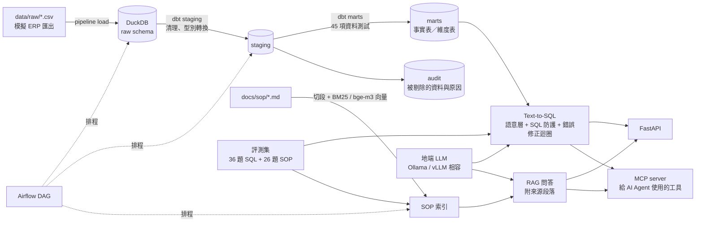

# ERP AI Copilot — local-LLM Text-to-SQL and SOP RAG over a dbt warehouse

[](https://github.com/gin7416/erp-ai-copilot/actions/workflows/ci.yml)

[繁體中文](#中文說明) | [English](#english-summary)

## 中文說明

**一句話：** 以一家虛構儲存裝置公司的 ERP／供應鏈資料為例，建立「資料管線 → 資料模型 → 地端 LLM 問答 → 量化評測」的完整流程，讓業務人員可以用中文問資料、查公司 SOP，而且每一個答案都可以被驗證。

> 所有資料（客戶、供應商、訂單、SOP）皆為程式產生的**虛構資料**，不含任何真實企業或個人資訊。

### 架構



### 各部分做了什麼

| 元件 | 內容 |
|---|---|
| **模擬資料** `generate_data.py` | 固定亂數種子產生 20 個產品、8 家供應商、30 位客戶、1,800 張銷售訂單、247 張採購單、360 筆庫存快照；**刻意埋入** 12 筆重複資料、5 筆數量 ≤ 0、大小寫與空白不一致的料號、英文拼法的地區名稱 |
| **資料管線** `pipeline.py` + **Airflow** `orchestration/dags/` | CSV 原樣（全字串）載入 DuckDB `raw` 層並記錄載入稽核；Airflow DAG 依序執行載入 → dbt build → 建立 SOP 索引 → 檢索品質回歸檢查，任務在專案自己的 virtualenv 執行，避免與 Airflow 套件版本衝突 |
| **dbt** `dbt/` | `staging`（清理、正規化、去重）→ `marts`（4 張維度表、3 張事實表）；`audit.dq_order_line_issues` 記錄每一筆被剔除的資料與原因；共 45 個 dbt 節點（模型 + unique／not_null／relationships／accepted_values 與自訂測試），包含「原始筆數 = 保留 + 剔除」的不遺失資料檢查 |
| **語意層** `semantic.py` | 直接讀取 dbt 的欄位說明（含商業規則，例如「營收須排除已取消訂單」「最新庫存只取最新快照」）放進 LLM 提示 |
| **SQL 防護** `sql_guard.py` + `warehouse.py` | 兩層防護：① sqlglot 解析，只允許單一 SELECT、只能查 `marts`、禁止 `read_csv` 等檔案函式、自動加 LIMIT；② DuckDB 唯讀連線、關閉外部檔案存取、查詢逾時中斷 |
| **Text-to-SQL** `text_to_sql.py` | 中文問題 → SQL → 執行；SQL 失敗或被防護擋下時，把錯誤訊息回饋給 LLM 再修正一次 |
| **RAG** `rag.py` | SOP 依章節切段；中文字元 bigram 的 BM25（不需斷詞套件）、bge-m3 向量檢索、兩者以 RRF 融合；回答必須附 [來源] 編號，找不到就說沒有 |
| **API** `api.py` | `/sql`、`/ask/data`、`/search/sop`、`/ask/sop`、`/tables`、`/health`；互動文件 `/docs` |
| **MCP server** `mcp_server.py` | 提供 `list_tables`、`run_sql`、`search_sop`、`ask_data` 四個唯讀工具，可接到 Claude Desktop 等 MCP 用戶端 |
| **評測** `evaluation/` + `eval/` | 36 題中文 Text-to-SQL 黃金問答（易／中／難）以執行結果比對；26 題 SOP 檢索題（含 8 題換句話說的題目）計算 Hit@k、MRR |
| **容器與 Kubernetes** `Dockerfile` + `k8s/` | 非 root 映像檔（建置時即產生資料倉儲與索引）；kustomize 管理 Namespace、ConfigMap、2 個副本的 API Deployment（就緒／存活探針、資源上下限、滾動更新不中斷）、Service，以及在叢集內執行整條資料管線與檢索檢查的 Job |

### 評測結果

完整報告：[`results/EVAL_REPORT.md`](results/EVAL_REPORT.md)（可用下方指令在自己的電腦重跑）。

> **關於測試題的來源：** 下面「自建測試題」的題目、標準答案、模擬資料和語意層說明都出自同一位作者，出題時已知道系統怎麼設計，因此數字可能高估真實使用時的準確率。

**Text-to-SQL**：qwen2.5-coder 3B（Ollama，temperature 0）在 Apple M1 8GB 筆電上執行，36 題中文問題，以查詢結果是否與標準答案一致計分。

| 提示設定 | SQL 可執行 | 答對（第一次） | 答對（含錯誤修正） | 延遲 p50／p95 |
|---|---|---|---|---|
| A. 只給表名與欄位型別 | 80.6% | 22.2%（8 題） | — | 3.8 秒／8.2 秒 |
| B. ＋ dbt 語意層（欄位說明、商業規則、2 個範例）＋ 錯誤修正迴圈 | 86.1% | 63.9%（23 題） | **66.7%（24 題）** | 4.1 秒／11.7 秒 |

- 語意層讓準確率從 22.2% 提高到 63.9%：小模型最常犯的錯是不知道商業規則（例如營收要排除已取消訂單），把規則寫進 dbt 欄位說明後大幅改善。
- 錯誤修正迴圈只多救回 1 題；剩下的 12 題錯誤中，7 題是邏輯錯（SQL 能執行但答案不對），5 題是兩次都寫不出可執行的 SQL（例如少 JOIN 供應商表、捏造不存在的資料表），每一題的原因都列在報告裡。

**SOP 檢索**：26 題（其中 8 題刻意換句話說，例如用「ChatGPT」問「外部公開 AI 服務」的規定），28 個段落。

| 檢索方法 | Hit@1 | Hit@3 | MRR |
|---|---|---|---|
| BM25（中文 bigram） | 84.6% | 96.2% | 0.897 |
| 向量（bge-m3） | 88.5% | 96.2% | 0.933 |
| 混合（RRF） | 88.5% | 96.2% | 0.923 |

- 向量檢索把第一名命中率從 84.6% 提高到 88.5%；三種方法漏掉的題目不同，在這麼小的文件集上混合檢索沒有比純向量更好，所以兩種都保留並以評測決定預設值。
- BM25 檢索門檻（Hit@3 ≥ 80%）同時是 CI 與 Airflow DAG 的回歸檢查。

### 快速開始

需要 Python 3.11+。不需要 GPU；LLM 相關功能需要 [Ollama](https://ollama.com)。

```bash
python -m venv .venv && source .venv/bin/activate
pip install -e ".[dev]"
python -m erp_copilot.pipeline all        # 載入 → dbt build（含資料測試）→ SOP 索引
pytest -q                                  # 66 項測試（另有 Airflow DAG 測試在 CI 執行）
```

啟用地端 LLM：

```bash
ollama pull qwen2.5-coder:3b
ollama pull bge-m3
EMBED_MODEL=bge-m3 python -m erp_copilot.pipeline index     # 加入向量索引
EMBED_MODEL=bge-m3 uvicorn erp_copilot.api:app --port 8000  # http://127.0.0.1:8000/docs
```

```bash
curl -s -X POST http://127.0.0.1:8000/ask/data -H 'Content-Type: application/json' \
  -d '{"question":"2025 年各地區的營收是多少？"}'
```

改用 vLLM 或其他 OpenAI 相容伺服器：`LLM_PROVIDER=openai LLM_BASE_URL=http://<host>:8000 LLM_MODEL=<model>`。

重跑評測：

```bash
python -m erp_copilot.evaluation sql --provider ollama --model qwen2.5-coder:3b
python -m erp_copilot.evaluation retrieval --modes bm25 dense hybrid
python -m erp_copilot.evaluation report
```

MCP（例如 Claude Desktop 的 `mcpServers` 設定）：

```json
{"erp-copilot": {"command": "/path/to/.venv/bin/python", "args": ["-m", "erp_copilot.mcp_server"],
                 "env": {"ERP_COPILOT_HOME": "/path/to/erp-ai-copilot"}}}
```

部署到 Kubernetes（以本機 [kind](https://kind.sigs.k8s.io) 叢集為例，需要 Docker）：

```bash
kind create cluster --name erp
docker build -t erp-ai-copilot:local . && kind load docker-image erp-ai-copilot:local --name erp
kubectl apply -k k8s/
kubectl -n erp-copilot rollout status deployment/erp-copilot-api
kubectl -n erp-copilot port-forward svc/erp-copilot-api 8080:80   # http://127.0.0.1:8080/docs
```

要啟用 LLM，把 `k8s/configmap.yaml` 的 `LLM_PROVIDER`／`LLM_BASE_URL` 指向叢集內的 Ollama 或 vLLM 服務。

### 持續整合

GitHub Actions 每次 push 執行四個工作：

- **tests**：Python 3.11／3.12／3.13，完整 pytest（每次都重新以 dbt 建出資料倉儲）、評測程式自我檢查（標準答案必須 100%）、BM25 檢索品質門檻。
- **airflow**：在獨立環境安裝 Apache Airflow 3，實際執行整條 `erp_pipeline` DAG，任一任務失敗即失敗。
- **docker**：建置映像檔、啟動 API，驗證查詢、SQL 防護與 SOP 搜尋。
- **kubernetes**：建立 kind 叢集，以 kustomize 部署；確認 2 個副本就緒、管線 Job 成功、容器以非 root 執行、透過 Service 的 API 測試通過，以及滾動重啟能順利完成。

### 限制與下一步

- 使用 3B 參數小模型在筆電上執行：答對 66.7%，跨表查詢與日期計算仍常出錯；評測報告列出了答錯的題目與原因。
- SOP 回答也用同一個 3B 程式碼模型，對換句話說的問題偏保守：例如問「可以把客戶報價貼到 ChatGPT 嗎？」時，正確段落已被檢索到第 2 名，模型仍回答「SOP 中沒有相關規定」。回答品質目前沒有納入自動評測（只評檢索），下一步是加入回答正確性評測並比較通用模型。
- 尚未做使用者驗證與權限分級（例如列／欄層級權限、個資遮罩）。
- Kubernetes 部署只在 CI 的 kind 單節點叢集驗證，沒有 Ingress、自動擴展與正式叢集的監控；資料倉儲是包在映像檔裡的唯讀檔案，正式環境應改由排程 Job 寫入共享儲存或資料庫。
- 下一步：在 GPU 伺服器以 vLLM 部署較大模型並比較準確率與延遲；把測試題擴充為業務單位共同維護的回歸測試。

## English summary

An end-to-end demo on synthetic ERP / supply-chain data for a fictional storage-device company:
CSV extracts → DuckDB `raw` → dbt `staging`/`marts` with 45 data tests and an audit table for rejected rows →
Text-to-SQL with a dbt-derived semantic layer, a two-layer SQL guard (sqlglot + read-only DuckDB) and an
error-feedback retry loop → RAG over SOP documents (Chinese bigram BM25, bge-m3 embeddings, RRF hybrid) →
FastAPI and an MCP server. An Airflow 3 DAG orchestrates the pipeline. A golden set of 36 Chinese business
questions and 26 SOP questions measures execution accuracy and retrieval quality with a local LLM (Ollama). The questions were written by the
author, so the numbers may overestimate accuracy on real users' questions.
CI runs the tests on Python 3.11–3.13, executes the full DAG under Airflow, smoke-tests the Docker image, and
deploys the stack with kustomize to a kind Kubernetes cluster (2-replica API Deployment, Service, pipeline Job,
non-root pods, rolling restart).
All data is synthetic.
