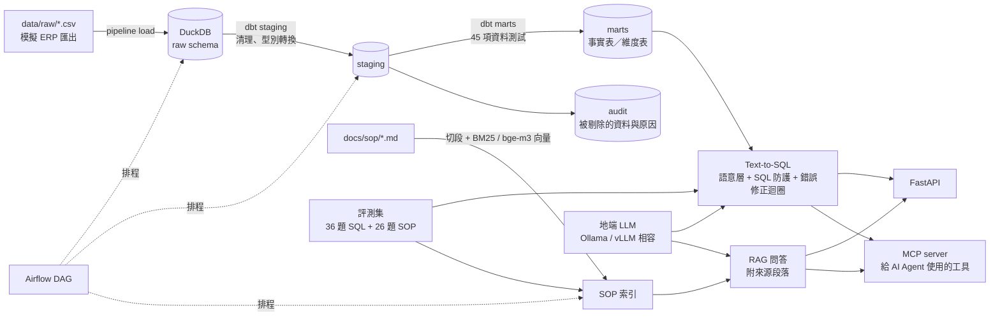

# ERP AI Copilot — local-LLM Text-to-SQL and SOP RAG over a dbt warehouse

[](https://github.com/gin7416/erp-ai-copilot/actions/workflows/ci.yml)

[繁體中文](#中文說明) | [English](#english-summary)

## 中文說明

**一句話：** 以一家虛構儲存裝置公司的 ERP／供應鏈資料為例，建立「資料管線 → 資料模型 → 地端 LLM 問答 → 量化評測」的完整流程，讓業務人員可以用中文問資料、查公司 SOP，而且每一個答案都可以被驗證。

> 所有資料（客戶、供應商、訂單、SOP）皆為程式產生的**虛構資料**，不含任何真實企業或個人資訊。

### 架構



### 各部分做了什麼

| 元件 | 內容 |
|---|---|
| **模擬資料** `generate_data.py` | 固定亂數種子產生 20 個產品、8 家供應商、30 位客戶、1,800 張銷售訂單、247 張採購單、360 筆庫存快照；**刻意埋入** 12 筆重複資料、5 筆數量 ≤ 0、大小寫與空白不一致的料號、英文拼法的地區名稱 |
| **資料管線** `pipeline.py` + **Airflow** `orchestration/dags/` | CSV 原樣（全字串）載入 DuckDB `raw` 層並記錄載入稽核；Airflow DAG 依序執行載入 → dbt build → 建立 SOP 索引 → 檢索品質回歸檢查，任務在專案自己的 virtualenv 執行，避免與 Airflow 套件版本衝突 |
| **dbt** `dbt/` | `staging`（清理、正規化、去重）→ `marts`（4 張維度表、3 張事實表）；`audit.dq_order_line_issues` 記錄每一筆被剔除的資料與原因；共 45 個 dbt 節點（模型 + unique／not_null／relationships／accepted_values 與自訂測試），包含「原始筆數 = 保留 + 剔除」的不遺失資料檢查 |
| **語意層** `semantic.py` | 直接讀取 dbt 的欄位說明（含商業規則，例如「營收須排除已取消訂單」「最新庫存只取最新快照」）放進 LLM 提示 |
| **SQL 防護** `sql_guard.py` + `warehouse.py` | 兩層防護：① sqlglot 解析，只允許單一 SELECT、只能查 `marts`、禁止 `read_csv` 等檔案函式、自動加 LIMIT；② DuckDB 唯讀連線、關閉外部檔案存取、查詢逾時中斷 |
| **Text-to-SQL** `text_to_sql.py` | 中文問題 → SQL → 執行；SQL 失敗或被防護擋下時，把錯誤訊息回饋給 LLM 再修正一次 |
| **RAG** `rag.py` | SOP 依章節切段；中文字元 bigram 的 BM25（不需斷詞套件）、bge-m3 向量檢索、兩者以 RRF 融合；回答必須附 [來源] 編號，找不到就說沒有 |
| **API** `api.py` | `/sql`、`/ask/data`、`/search/sop`、`/ask/sop`、`/tables`、`/health`；互動文件 `/docs` |
| **MCP server** `mcp_server.py` | 提供 `list_tables`、`run_sql`、`search_sop`、`ask_data` 四個唯讀工具，可接到 Claude Desktop 等 MCP 用戶端 |
| **評測** `evaluation/` + `eval/` | 36 題中文 Text-to-SQL 黃金問答（易／中／難）以執行結果比對；26 題 SOP 檢索題（含 8 題換句話說的題目）計算 Hit@k、MRR；比較不同提示設定與檢索方法 |

### 評測結果

完整報告：[`results/EVAL_REPORT.md`](results/EVAL_REPORT.md)（可用下方指令在自己的電腦重跑）。

（評測結果整理中。）

### 快速開始

需要 Python 3.11+。不需要 GPU；LLM 相關功能需要 [Ollama](https://ollama.com)。

```bash
python -m venv .venv && source .venv/bin/activate
pip install -e ".[dev]"
python -m erp_copilot.pipeline all        # 載入 → dbt build（含資料測試）→ SOP 索引
pytest -q                                  # 64 項測試（另有 Airflow DAG 測試在 CI 執行）
```

啟用地端 LLM：

```bash
ollama pull qwen2.5-coder:3b
ollama pull bge-m3
EMBED_MODEL=bge-m3 python -m erp_copilot.pipeline index     # 加入向量索引
EMBED_MODEL=bge-m3 uvicorn erp_copilot.api:app --port 8000  # http://127.0.0.1:8000/docs
```

```bash
curl -s -X POST http://127.0.0.1:8000/ask/data -H 'Content-Type: application/json' \
  -d '{"question":"2025 年各地區的營收是多少？"}'
```

改用 vLLM 或其他 OpenAI 相容伺服器：`LLM_PROVIDER=openai LLM_BASE_URL=http://<host>:8000 LLM_MODEL=<model>`。

重跑評測：

```bash
python -m erp_copilot.evaluation sql --provider ollama --model qwen2.5-coder:3b
python -m erp_copilot.evaluation retrieval --modes bm25 dense hybrid
python -m erp_copilot.evaluation report
```

MCP（例如 Claude Desktop 的 `mcpServers` 設定）：

```json
{"erp-copilot": {"command": "/path/to/.venv/bin/python", "args": ["-m", "erp_copilot.mcp_server"],
                 "env": {"ERP_COPILOT_HOME": "/path/to/erp-ai-copilot"}}}
```

### 持續整合

GitHub Actions 每次 push 執行三個工作：

- **tests**：Python 3.11／3.12／3.13，完整 pytest（每次都重新以 dbt 建出資料倉儲）、評測程式自我檢查（標準答案必須 100%）、BM25 檢索品質門檻。
- **airflow**：在獨立環境安裝 Apache Airflow 3，實際執行整條 `erp_pipeline` DAG，任一任務失敗即失敗。
- **docker**：建置映像檔、啟動 API，驗證查詢、SQL 防護與 SOP 搜尋。

### 限制與下一步

- 使用 3B 參數小模型在筆電上執行，複雜問題（多表、視窗函數）仍會出錯；評測報告列出了仍答錯的題目與原因。
- 尚未做使用者驗證與權限分級（例如列／欄層級權限、個資遮罩）。
- 下一步：在 GPU 伺服器以 vLLM 部署較大模型並比較準確率與延遲；把黃金問答集擴充為業務單位共同維護的回歸測試。

## English summary

An end-to-end demo on synthetic ERP / supply-chain data for a fictional storage-device company:
CSV extracts → DuckDB `raw` → dbt `staging`/`marts` with 45 data tests and an audit table for rejected rows →
Text-to-SQL with a dbt-derived semantic layer, a two-layer SQL guard (sqlglot + read-only DuckDB) and an
error-feedback retry loop → RAG over SOP documents (Chinese bigram BM25, bge-m3 embeddings, RRF hybrid) →
FastAPI and an MCP server. An Airflow 3 DAG orchestrates the pipeline. A golden set of 36 Chinese business
questions and 26 SOP questions measures execution accuracy and retrieval quality with a local LLM (Ollama),
and CI runs the tests on Python 3.11–3.13, executes the full DAG under Airflow, and smoke-tests the Docker image.
All data is synthetic.
